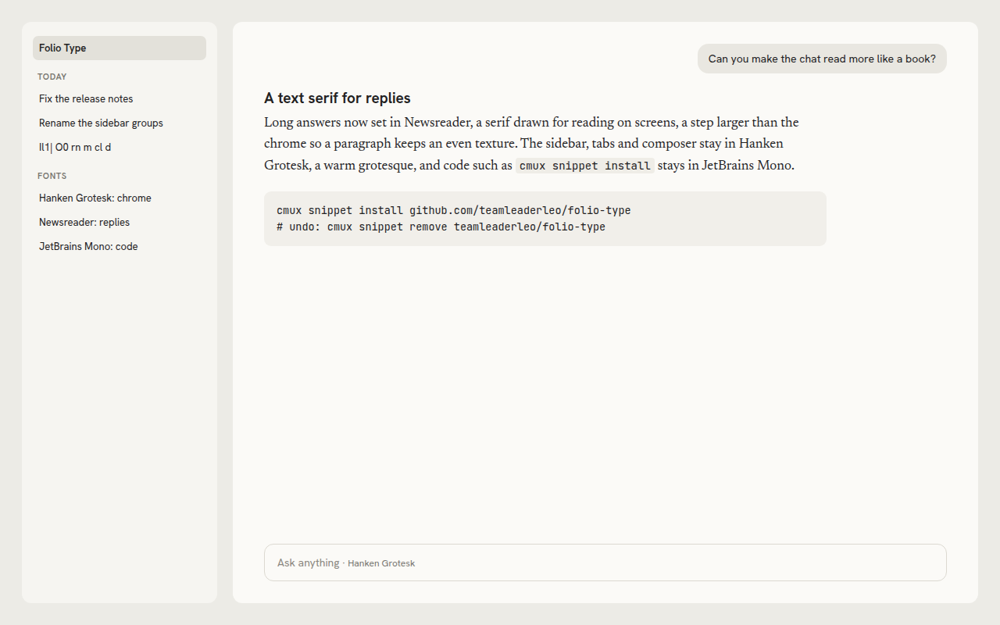

# Folio Type

[](https://cmux.com/extensions/teamleaderleo/folio-type)

Bookish type for cmux. A warm grotesque for the chrome, a text serif for agent replies and
Markdown, a clear mono for code. Colors stay yours: it changes only the fonts, so it sits on top of
any theme (Teal Twin included). No code runs, and nothing needs installing on your Mac: the three
fonts are inlined in the stylesheets.



| Where | Font | Why |
| --- | --- | --- |
| Sidebar, tabs, composer, cards, Markdown headings | Hanken Grotesk | An open, warm grotesque with a little character in its round letters; clear at 11 to 13 px |
| Agent replies (15 px, a step larger) and Markdown text | Newsreader | A text serif drawn for long reading on screens, with sturdy serifs and an even texture |
| Code, in the chat and in Markdown | JetBrains Mono | Distinct `Il1|` and `O0`, a tall x-height, no ligature surprises |

It is in the spirit of editorial brand type that sets a slightly quirky grotesque beside a sturdy
book serif, made only from fonts under the SIL Open Font License.

## Install

```sh
cmux snippet install github.com/teamleaderleo/folio-type
```

Or open it in the App Store on [cmux.com](https://cmux.com/extensions/teamleaderleo/folio-type). cmux
shows one line (what it is, where it comes from, that no code runs) and asks first. It applies at once.

`cmux snippet remove teamleaderleo/folio-type` puts back the look you had (your own
`agent-pane/theme.css` and `markdown/theme.css` too, if you had them).

## What it changes

- `agent-pane/theme.css`: the agent chat's chrome font (`--font-ui`), its reply font and size
  (`--cv-font`, 15 px on 24 px lines) and its code font (`--cv-mono`).
- `markdown/theme.css`: the Markdown viewer's text, heading and code fonts
  (`--cmux-md-font-family`, `--cmux-md-heading-font-family`, `--cmux-md-code-font-family`).

The terminal keeps its own font. To use JetBrains Mono there too, install `fonts/jetbrains-mono.woff2`
(or JetBrains Mono from its project) and run `cmux settings set terminal.fontFamily "JetBrains Mono"`.

## Fonts and licenses

Every font here is under the [SIL Open Font License 1.1](fonts/OFL.txt), which allows bundling and
redistributing it with its notice. None of the three declares a Reserved Font Name.

| Font | Copyright | License | File |
| --- | --- | --- | --- |
| Hanken Grotesk | 2021 The Hanken Grotesk Project Authors ([marcologous/hanken-grotesk](https://github.com/marcologous/hanken-grotesk)) | OFL 1.1 | `fonts/hanken-grotesk.woff2` |
| Newsreader | 2020 The Newsreader Project Authors ([productiontype/Newsreader](https://github.com/productiontype/Newsreader)) | OFL 1.1 | `fonts/newsreader.woff2` |
| JetBrains Mono | 2020 The JetBrains Mono Project Authors ([JetBrains/JetBrainsMono](https://github.com/JetBrains/JetBrainsMono)) | OFL 1.1 | `fonts/jetbrains-mono.woff2` |

The files are the Latin variable-weight subsets Fontsource publishes
(`@fontsource-variable/<name>` 5.2.10, `files/<name>-latin-wght-normal.woff2`), byte for byte; the
stylesheets inline the same bytes as base64 `data:` URLs. `fonts/OFL.txt` has each notice and the
license text. The stylesheets, this README and `tools/` are MIT ([LICENSE](LICENSE)).

## Make your own

1. Put `agent-pane/theme.css` and/or `markdown/theme.css` in a repo, with a `cmux-snippet.json` at
   the root like this one (`id` starts with your GitHub name). Fonts go in as `data:` URLs: a
   snippet loads nothing from the network.
2. `cmux theme check .` reports anything cmux would not load.
3. Tag a release with the version (`1.0.0`) and add the topics `cmux-extension` and `cmux-snippet`
   (repo page, the gear beside About, Topics).
4. Open a PR adding it to `snippets.json` in
   [manaflow-ai/cmux-extensions](https://github.com/manaflow-ai/cmux-extensions) to list it on cmux.com.

`tools/render.sh` redraws `screenshots/preview.png` from `tools/preview.html` with headless Chrome.
